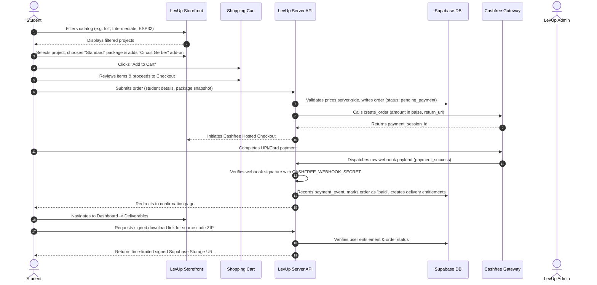
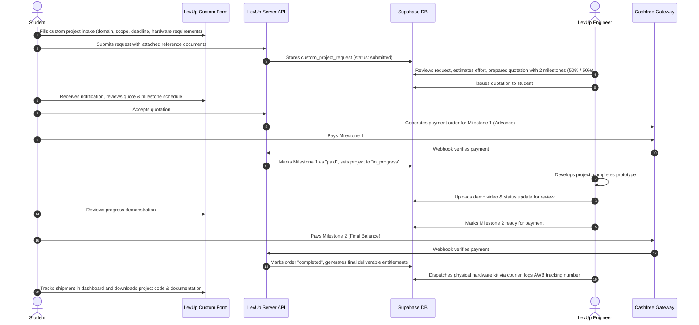
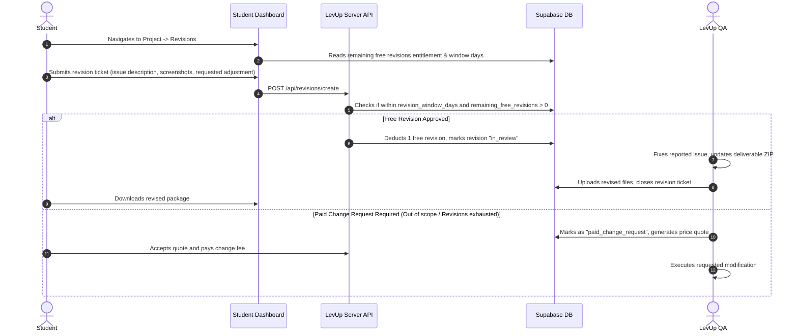

# User Journeys — LevUp Projects

**Document Status:** Baseline  
**Last Updated:** 2026-11-17

---

## 1. Journey 1: Student Browses & Purchases Ready-Made Project Kit

---

## 2. Journey 2: Student Requests Custom Project with Milestone Payments

---

## 3. Journey 3: Student Requests Post-Delivery Revision

