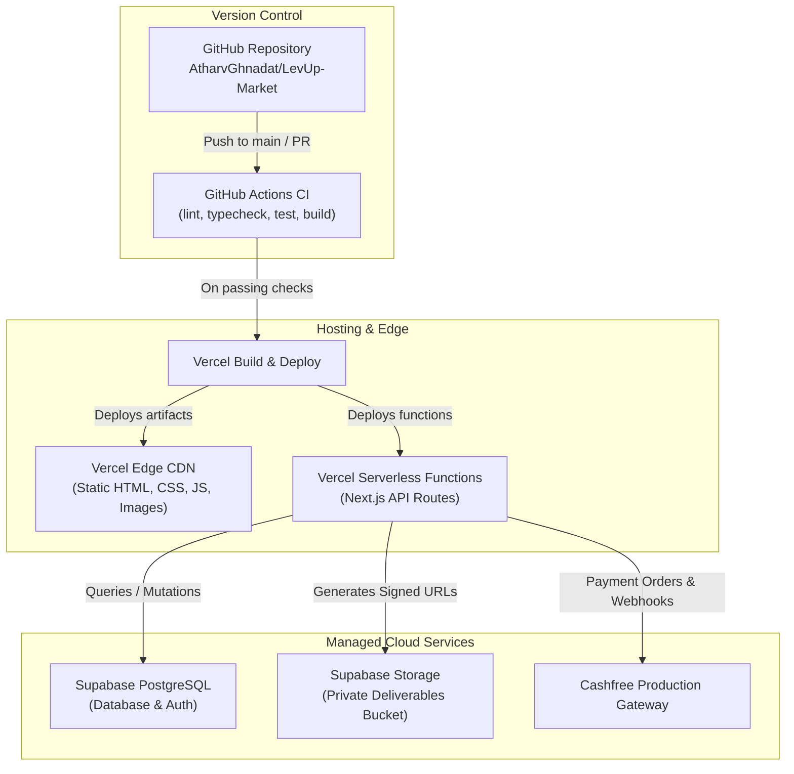

# Deployment Architecture — LevUp Projects

**Document Status:** Baseline  
**Last Updated:** 2026-11-17

---

## 1. Deployment Topology

---

## 2. Environments

| Environment           | Branch                           | URL Pattern                                                        | Database Instance            | Cashfree Mode                        |
| --------------------- | -------------------------------- | ------------------------------------------------------------------ | ---------------------------- | ------------------------------------ |
| **Local Development** | feature branches                 | `http://localhost:8443` (Vite) / `http://localhost:3000` (Next.js) | Supabase Local / Dev project | Sandbox                              |
| **Preview / Staging** | `chore/*`, `feat/*`, `fix/*` PRs | `https://levup-market-git-*.vercel.app`                            | Supabase Staging project     | Sandbox                              |
| **Production**        | `main` (tagged releases only)    | `https://levupprojects.com` / `https://levup-market.vercel.app`    | Supabase Production project  | Production (after merchant approval) |

---

## 3. Deployment Pipeline & Verification Steps

1. **Pull Request Gate**:
   - Push to branch triggers GitHub Actions `.github/workflows/ci.yml`.
   - Steps: `pnpm install --frozen-lockfile` → `pnpm typecheck` → `pnpm build`.
   - Vercel automatically deploys an isolated Preview Deployment with ephemeral preview URL.
2. **Review & Visual Parity**:
   - Verify changes against Figma Make reference on mobile, tablet, and desktop viewports.
3. **Merge Gate**:
   - Merge to `main` permitted only with passing CI and pull request approval.
4. **Post-Deployment Smoke Test**:
   - Automatic healthcheck verifying `GET /` responds with 200 OK.
   - Catalog loads and renders projects within SLA (< 1.5s TTFB).
   - Record deployment entry in `docs/10-releases/DEPLOYMENT_HISTORY.md`.
