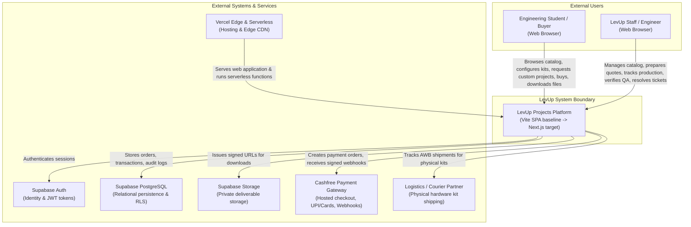

# System Context — LevUp Projects

**Document Status:** Baseline  
**Last Updated:** 2026-11-17

---

## 1. System Context Diagram (C4 Level 1)

---

## 2. External Actors and Interactions

| Actor / System | Interaction Purpose                                                                                | Protocol / Format                   |
| -------------- | -------------------------------------------------------------------------------------------------- | ----------------------------------- |
| **Student**    | Catalog browsing, custom inquiry submission, order placement, download of deliverables             | HTTPS / HTML, JSON                  |
| **Admin**      | Catalog maintenance, quotation authoring, order production progression, QA approval, audit queries | HTTPS / RBAC + MFA                  |
| **Cashfree**   | Server-to-server payment order generation, asynchronous payment notification via signed webhooks   | HTTPS / REST, HMAC-SHA256 signature |
| **Supabase**   | Authoritative data store, row-level security, auth token verification, private file storage        | HTTPS / PostgreSQL, REST, S3 API    |
| **Vercel**     | Application deployment, edge caching, serverless API execution                                     | Git-driven CI/CD deployment         |
