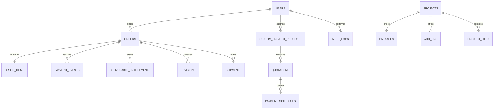

# Database Schema Specification — LevUp Projects

**Document Status:** Baseline / Proposed PostgreSQL Schema  
**Database Engine:** PostgreSQL 16 (via Supabase)  
**Last Updated:** 2026-11-17

---

## 1. Schema Overview



---

## 2. Core DDL Table Definitions

```sql
-- Enable necessary extensions
CREATE EXTENSION IF NOT EXISTS "uuid-ossp";
CREATE EXTENSION IF NOT EXISTS "pgcrypto";

-- ENUMS
CREATE TYPE project_type_enum AS ENUM ('ready-made', 'built-on-order', 'customizable');
CREATE TYPE delivery_type_enum AS ENUM ('digital', 'physical', 'hybrid');
CREATE TYPE difficulty_enum AS ENUM ('beginner', 'intermediate', 'advanced');
CREATE TYPE order_status_enum AS ENUM ('draft', 'pending_payment', 'paid', 'in_progress', 'qa_review', 'shipped', 'delivered', 'cancelled', 'refunded');
CREATE TYPE payment_status_enum AS ENUM ('initiated', 'pending', 'successful', 'failed', 'refunded');
CREATE TYPE revision_status_enum AS ENUM ('submitted', 'in_review', 'in_progress', 'completed', 'rejected', 'converted_to_paid');

-- 1. PROFILES (Extends Supabase auth.users)
CREATE TABLE public.profiles (
    id UUID PRIMARY KEY REFERENCES auth.users(id) ON DELETE CASCADE,
    full_name TEXT NOT NULL,
    email TEXT NOT NULL UNIQUE,
    phone_number TEXT,
    college_name TEXT,
    degree_branch TEXT,
    shipping_address JSONB,
    created_at TIMESTAMPTZ NOT NULL DEFAULT timezone('utc', now()),
    updated_at TIMESTAMPTZ NOT NULL DEFAULT timezone('utc', now())
);

-- 2. ADMIN USERS ALLOWLIST
CREATE TABLE public.admin_users (
    user_id UUID PRIMARY KEY REFERENCES auth.users(id) ON DELETE CASCADE,
    role TEXT NOT NULL DEFAULT 'admin' CHECK (role IN ('superadmin', 'admin', 'qa_engineer', 'support')),
    is_active BOOLEAN NOT NULL DEFAULT true,
    added_at TIMESTAMPTZ NOT NULL DEFAULT timezone('utc', now()),
    added_by UUID REFERENCES auth.users(id)
);

-- 3. CATEGORIES
CREATE TABLE public.categories (
    id TEXT PRIMARY KEY,
    name TEXT NOT NULL,
    slug TEXT NOT NULL UNIQUE,
    description TEXT,
    image_id TEXT NOT NULL,
    display_order INT NOT NULL DEFAULT 0
);

-- 4. PROJECTS
CREATE TABLE public.projects (
    id TEXT PRIMARY KEY, -- e.g. 'LP-1001'
    slug TEXT NOT NULL UNIQUE,
    title TEXT NOT NULL,
    summary TEXT NOT NULL,
    category_id TEXT NOT NULL REFERENCES public.categories(id),
    project_type project_type_enum NOT NULL,
    delivery_type delivery_type_enum NOT NULL,
    difficulty difficulty_enum NOT NULL,
    technologies TEXT[] NOT NULL DEFAULT '{}',
    deliverables TEXT[] NOT NULL DEFAULT '{}',
    customizable BOOLEAN NOT NULL DEFAULT false,
    starting_price_paise INT NOT NULL CHECK (starting_price_paise >= 0),
    is_published BOOLEAN NOT NULL DEFAULT false,
    created_at TIMESTAMPTZ NOT NULL DEFAULT timezone('utc', now()),
    updated_at TIMESTAMPTZ NOT NULL DEFAULT timezone('utc', now())
);

-- 5. PACKAGES (Tiers: Basic, Standard, Premium)
CREATE TABLE public.project_packages (
    id UUID PRIMARY KEY DEFAULT gen_random_uuid(),
    project_id TEXT NOT NULL REFERENCES public.projects(id) ON DELETE CASCADE,
    name TEXT NOT NULL CHECK (name IN ('Basic', 'Standard', 'Premium')),
    price_paise INT NOT NULL CHECK (price_paise >= 0),
    short_description TEXT NOT NULL,
    deliverables TEXT[] NOT NULL,
    free_revisions INT NOT NULL DEFAULT 1,
    revision_window_days INT NOT NULL DEFAULT 14,
    support_days INT NOT NULL DEFAULT 14,
    created_at TIMESTAMPTZ NOT NULL DEFAULT timezone('utc', now()),
    UNIQUE(project_id, name)
);

-- 6. ADD_ONS
CREATE TABLE public.project_add_ons (
    id TEXT PRIMARY KEY, -- e.g. 'circuit-files'
    name TEXT NOT NULL,
    description TEXT NOT NULL,
    price_paise INT CHECK (price_paise >= 0), -- NULL indicates quote required
    makes_physical BOOLEAN NOT NULL DEFAULT false,
    created_at TIMESTAMPTZ NOT NULL DEFAULT timezone('utc', now())
);

-- 7. ORDERS
CREATE TABLE public.orders (
    id TEXT PRIMARY KEY, -- e.g. 'ord_lp_<uuid>'
    user_id UUID NOT NULL REFERENCES public.profiles(id),
    status order_status_enum NOT NULL DEFAULT 'draft',
    subtotal_paise INT NOT NULL CHECK (subtotal_paise >= 0),
    tax_paise INT NOT NULL DEFAULT 0 CHECK (tax_paise >= 0),
    total_paise INT NOT NULL CHECK (total_paise >= 0),
    currency TEXT NOT NULL DEFAULT 'INR',
    shipping_address JSONB,
    cashfree_order_id TEXT UNIQUE,
    created_at TIMESTAMPTZ NOT NULL DEFAULT timezone('utc', now()),
    updated_at TIMESTAMPTZ NOT NULL DEFAULT timezone('utc', now())
);

-- 8. ORDER ITEMS (Immutable Snapshot)
CREATE TABLE public.order_items (
    id UUID PRIMARY KEY DEFAULT gen_random_uuid(),
    order_id TEXT NOT NULL REFERENCES public.orders(id) ON DELETE CASCADE,
    project_id TEXT NOT NULL REFERENCES public.projects(id),
    package_name TEXT NOT NULL,
    package_price_paise INT NOT NULL,
    selected_add_ons JSONB NOT NULL DEFAULT '[]',
    item_total_paise INT NOT NULL,
    created_at TIMESTAMPTZ NOT NULL DEFAULT timezone('utc', now())
);

-- 9. PAYMENT EVENTS (Immutable Financial Log)
CREATE TABLE public.payment_events (
    id UUID PRIMARY KEY DEFAULT gen_random_uuid(),
    order_id TEXT NOT NULL REFERENCES public.orders(id),
    event_id TEXT NOT NULL UNIQUE, -- From Cashfree webhook to enforce idempotency
    event_type TEXT NOT NULL,
    status payment_status_enum NOT NULL,
    amount_paise INT NOT NULL,
    raw_payload JSONB NOT NULL,
    created_at TIMESTAMPTZ NOT NULL DEFAULT timezone('utc', now())
);

-- 10. DELIVERABLE ENTITLEMENTS
CREATE TABLE public.deliverable_entitlements (
    id UUID PRIMARY KEY DEFAULT gen_random_uuid(),
    order_id TEXT NOT NULL REFERENCES public.orders(id) ON DELETE CASCADE,
    user_id UUID NOT NULL REFERENCES public.profiles(id),
    storage_path TEXT NOT NULL, -- Path in private bucket
    file_name TEXT NOT NULL,
    file_type TEXT NOT NULL,
    file_size_bytes BIGINT NOT NULL,
    is_active BOOLEAN NOT NULL DEFAULT true,
    created_at TIMESTAMPTZ NOT NULL DEFAULT timezone('utc', now())
);

-- 11. AUDIT LOGS (Immutable Operations Log)
CREATE TABLE public.audit_logs (
    id UUID PRIMARY KEY DEFAULT gen_random_uuid(),
    actor_id UUID REFERENCES auth.users(id),
    action TEXT NOT NULL,
    resource_type TEXT NOT NULL,
    resource_id TEXT NOT NULL,
    metadata JSONB,
    ip_address INET,
    user_agent TEXT,
    created_at TIMESTAMPTZ NOT NULL DEFAULT timezone('utc', now())
);
```
