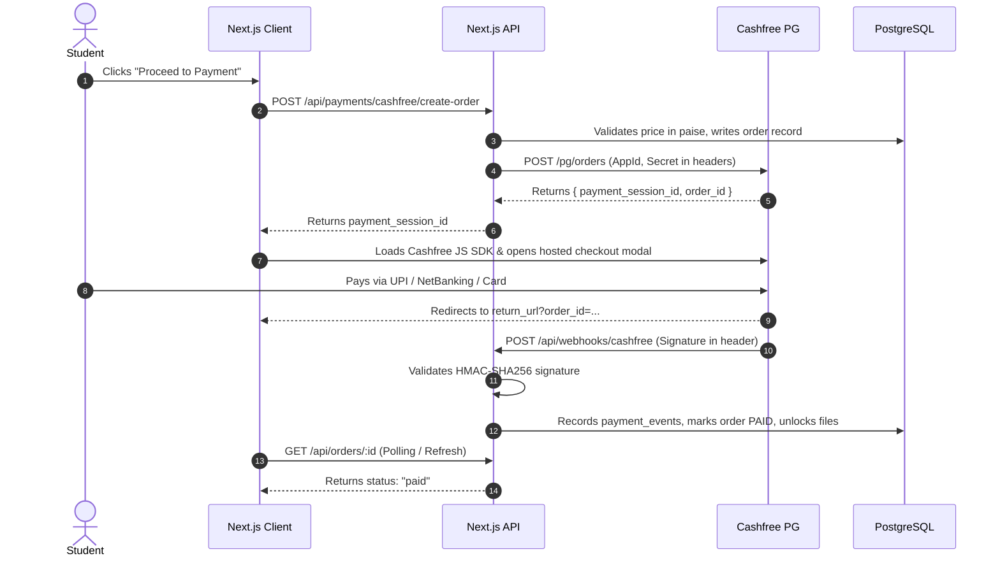

# Cashfree Payment Gateway Integration — LevUp Projects

**Document Status:** Baseline  
**Gateway Partner:** Cashfree Payments India  
**Last Updated:** 2026-11-17  

---

## 1. Integration Model: Hosted Checkout + Server-Side Verification

LevUp Projects employs Cashfree's **Hosted Checkout** flow to ensure sensitive cardholder and banking data never traverses LevUp servers.

---

## 2. API Credentials & Sandboxing

- **Development Sandbox URL**: `https://sandbox.cashfree.com/pg`
- **Production API URL**: `https://api.cashfree.com/pg`
- **Merchant Approval Requirement**: Real payment testing against production endpoints is strictly prohibited until business verification and website policy compliance audits are certified.
