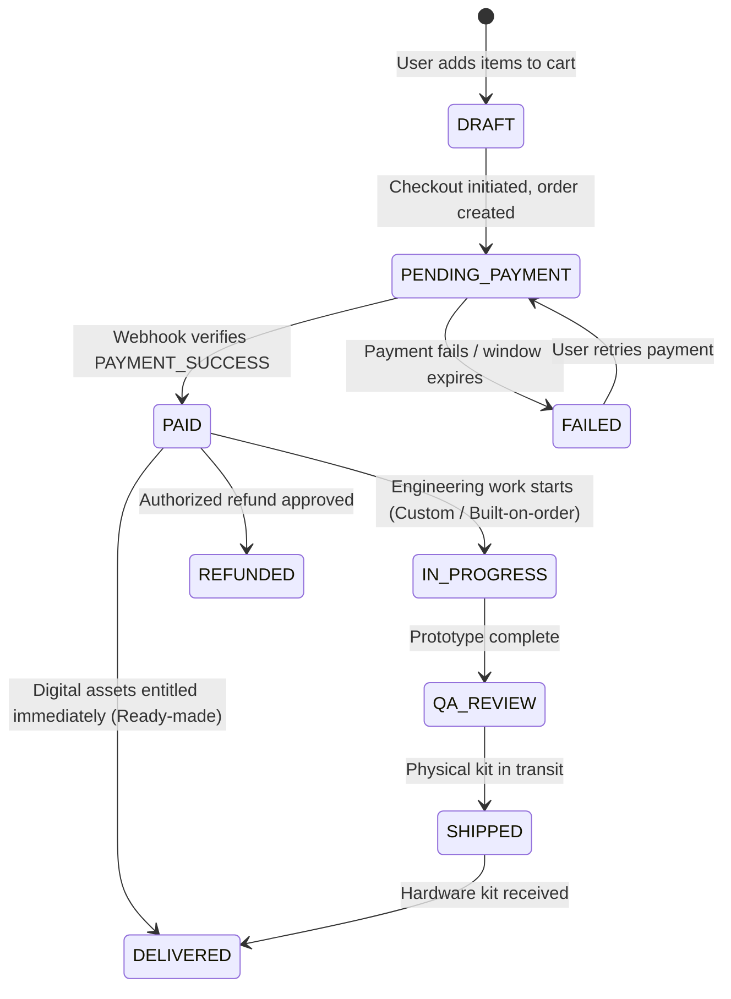

# Payment Lifecycle Specification — LevUp Projects

**Document Status:** Baseline  
**Last Updated:** 2026-11-17

---

## 1. State Machine: Order & Payment Status

---

## 2. Terminal vs. Non-Terminal States

- `DRAFT`: Ephemeral, client-side only.
- `PENDING_PAYMENT`: Valid for 30 minutes from creation.
- `PAID`: Irreversible state transition upon verified cryptographic webhook. Unlocks deliverable entitlements.
- `REFUNDED`: Terminal financial state. Revokes deliverable access.
